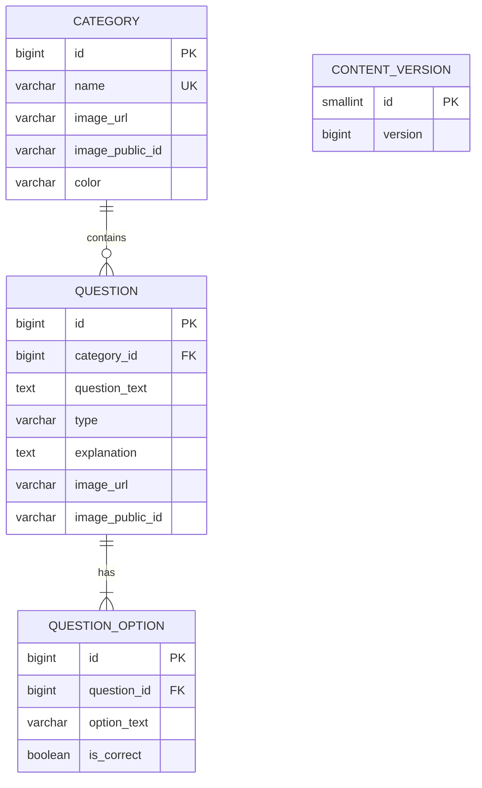

# Quiz App – Backend

REST API for an offline-first quiz app. It stores categories and questions, lets an admin manage them (including images), and gives the mobile app a cheap way to know when its local copy is out of date and a single endpoint to download everything.

The mobile client is built with Flutter and plays entirely from a local database. This backend is only contacted on launch to check the content version and, if it changed, to download the full content.

## Features

- Categories with an optional image and colour
- Questions in two types: **true/false** (2 options) or **multiple choice** (4 options), each with an optional explanation and an optional image
- **Content versioning**: a single global version number that increases on every successful change, so clients only re-download when something changed
- **Full sync endpoint** returning a consistent snapshot of the version, all categories and all questions with their options
- **Image upload** to Cloudinary, with automatic cleanup of replaced or orphaned images
- **JSON seed loader** to bulk-load categories and questions from files
- **API key protection** for every write operation; reads stay public
- Consistent error responses in the standard `ProblemDetail` (RFC 9457) format

## Tech stack

| Area | Technology |
|---|---|
| Language / runtime | Java 21 |
| Framework | Spring Boot 4.1 (Web, Data JPA, Validation) |
| Database | PostgreSQL (developed against 18) |
| Migrations | Flyway |
| Image storage | Cloudinary |
| Build | Maven |
| Testing | JUnit 5, Mockito, AssertJ, Spring MockMvc, Testcontainers |
| Boilerplate reduction | Lombok |

## Getting started

### Prerequisites

- JDK 21
- PostgreSQL, with an empty database named `quiz_db`
- A free [Cloudinary](https://cloudinary.com) account (only needed for image upload)
- Docker (only needed to run the integration tests)

### 1. Create the database

```sql
CREATE DATABASE quiz_db;
```

Flyway creates all tables on the first start.

### 2. Configure environment variables

| Variable | Required | Purpose |
|---|---|---|
| `DB_USERNAME` | yes | PostgreSQL user |
| `DB_PASSWORD` | yes | PostgreSQL password |
| `APP_API_KEY` | for writes | Secret that write requests must send in the `X-API-Key` header. If unset, **all writes are rejected** |
| `CLOUDINARY_CLOUD_NAME` | for images | Cloudinary cloud name |
| `CLOUDINARY_API_KEY` | for images | Cloudinary API key |
| `CLOUDINARY_API_SECRET` | for images | Cloudinary API secret |

Never commit these values. Generate a strong `APP_API_KEY` with:

```powershell
$bytes = New-Object byte[] 32; [System.Security.Cryptography.RandomNumberGenerator]::Create().GetBytes($bytes); [Convert]::ToBase64String($bytes)
```

### 3. Run

```bash
./mvnw spring-boot:run
```

(On Windows use `.\mvnw.cmd spring-boot:run`.) The API is then available at `http://localhost:8080`.

On the first start, the seed loader fills the database from the files in `src/main/resources/seed/`.

### Production profile

Run with `SPRING_PROFILES_ACTIVE=prod` to use `application-prod.properties`:

| Variable | Purpose |
|---|---|
| `DB_URL` | Full JDBC URL of the production database (required) |
| `DB_USERNAME`, `DB_PASSWORD` | Database credentials (required) |
| `PORT` | Port to listen on (defaults to 8080) |
| `APP_SEED_ENABLED` | Set to `true` for the very first deploy to load the seed files, then switch back off |

In the production profile, seeding is off by default and stack traces and internal error messages are never included in responses.

## Testing

```bash
./mvnw test
```

(On Windows use `.\mvnw.cmd test`.) The suite has two layers:

**Unit tests** run in seconds with no external services. They use mocked repositories to check the business rules in isolation:

- option validation (right number of options for the type, exactly one correct answer, no duplicates)
- the content version is bumped exactly once on a successful write and never on a rejected one
- a category cannot be deleted while it still has questions
- replaced or removed images are scheduled for cleanup
- the API key interceptor lets reads through and rejects every write without a valid key, including when no key is configured

**Integration tests** start the whole application against a throwaway PostgreSQL container (Testcontainers), so **Docker must be running**. Your own database is never touched. They send real HTTP requests through MockMvc and check:

- the real Flyway migration and Hibernate schema validation
- create, update and delete for categories and questions, including the database rules (option rows are removed when a question is updated or deleted, and a category with questions cannot be deleted)
- the content version in the database, which goes up only on successful writes
- the sync endpoint, which returns the version together with all categories and questions
- the API key check, including that rejected image uploads never reach the image service
- the error format for validation errors, malformed JSON, unknown URLs, wrong methods and unsupported content types

Cloudinary is replaced by a mock in the tests, so no real uploads happen.

The first run downloads the PostgreSQL Docker image and is slow. Later runs are much faster.

Run one group at a time:

```bash
./mvnw test -Dtest="*IntegrationTest"
./mvnw test -Dtest="*ServiceTest,ApiKeyInterceptorTest"
```

## Seeding content

Each file in `src/main/resources/seed/` describes one category and its questions:

```json
{
  "category": { "name": "Science", "color": "#2E86DE" },
  "questions": [
    {
      "questionText": "Which planet is known as the Red Planet?",
      "type": "MULTIPLE_CHOICE",
      "explanation": "Mars looks red because of iron oxide on its surface.",
      "options": [
        { "text": "Venus", "correct": false },
        { "text": "Mars", "correct": true },
        { "text": "Jupiter", "correct": false },
        { "text": "Mercury", "correct": false }
      ]
    },
    {
      "questionText": "Water boils at 100°C at sea level.",
      "type": "TRUE_FALSE",
      "options": [
        { "text": "True", "correct": true },
        { "text": "False", "correct": false }
      ]
    }
  ]
}
```

How the loader behaves:

- It goes through the files in alphabetical order and **skips any file whose category already exists**, so adding a new file and restarting loads only that file.
- All new files from one startup are loaded in **a single transaction**. If any question is invalid, nothing is saved and the app refuses to start with a message naming the file and question number.
- Seed data goes through the same validation as the API.
- Editing a file whose category is already loaded has no effect. Use the API for corrections.
- Images are not part of seed files. Attach them through the image endpoints.

## API reference

All request and response bodies are JSON unless noted. **Write operations** (`POST`, `PUT`, `DELETE`) require the header `X-API-Key: <your key>`. `GET` requests need no key.

### Content (used by the mobile app)

| Method | Path | Description |
|---|---|---|
| `GET` | `/api/content/version` | Current content version, e.g. `{"version": 12}` |
| `GET` | `/api/content/sync` | Version, all categories and all questions with options, read from one consistent snapshot |

Sync response shape:

```json
{
  "version": 12,
  "categories": [
    { "id": 1, "name": "Space", "imageUrl": "https://...", "color": "#2E86DE" }
  ],
  "questions": [
    {
      "id": 7,
      "categoryId": 1,
      "questionText": "Which planet is known as the Red Planet?",
      "type": "MULTIPLE_CHOICE",
      "explanation": "Mars looks red because of iron oxide on its surface.",
      "imageUrl": null,
      "options": [
        { "id": 25, "text": "Venus", "correct": false },
        { "id": 26, "text": "Mars", "correct": true }
      ]
    }
  ]
}
```

### Categories

| Method | Path | Auth | Description |
|---|---|---|---|
| `GET` | `/api/categories` | – | List categories, sorted by name |
| `GET` | `/api/categories/{id}` | – | Get one category |
| `POST` | `/api/categories` | key | Create a category |
| `PUT` | `/api/categories/{id}` | key | Replace a category's name and colour |
| `DELETE` | `/api/categories/{id}` | key | Delete a category (blocked while it still has questions) |
| `POST` | `/api/categories/{id}/image` | key | Upload or replace the image (`multipart/form-data`, part name `file`) |
| `DELETE` | `/api/categories/{id}/image` | key | Remove the image |

Create / update body:

```json
{ "name": "Science", "color": "#2E86DE" }
```

`name` is required (max 100 characters, unique ignoring case). `color` is optional and must be a hex code such as `#2E86DE`.

### Questions

| Method | Path | Auth | Description |
|---|---|---|---|
| `GET` | `/api/categories/{categoryId}/questions` | – | All questions in a category, with options |
| `GET` | `/api/questions/{id}` | – | Get one question |
| `POST` | `/api/questions` | key | Create a question |
| `PUT` | `/api/questions/{id}` | key | Replace a question (including all its options) |
| `DELETE` | `/api/questions/{id}` | key | Delete a question and its options |
| `POST` | `/api/questions/{id}/image` | key | Upload or replace the image (`multipart/form-data`, part name `file`) |
| `DELETE` | `/api/questions/{id}/image` | key | Remove the image |

Create / update body:

```json
{
  "categoryId": 1,
  "questionText": "Which planet is known as the Red Planet?",
  "type": "MULTIPLE_CHOICE",
  "explanation": "Mars looks red because of iron oxide on its surface.",
  "options": [
    { "text": "Venus", "correct": false },
    { "text": "Mars", "correct": true },
    { "text": "Jupiter", "correct": false },
    { "text": "Mercury", "correct": false }
  ]
}
```

Rules enforced by the API:

- `type` is `TRUE_FALSE` (exactly 2 options) or `MULTIPLE_CHOICE` (exactly 4 options)
- Exactly one option is marked `correct`
- Option texts are unique within a question (ignoring case and surrounding spaces)
- `PUT` replaces the whole question: omitted optional fields such as `explanation` are cleared, and the options are replaced. The image is not affected.

### Images

Images are uploaded with `multipart/form-data` using a part named `file`. Allowed types are JPEG, PNG and WebP, up to 5 MB. Uploading to an item that already has an image replaces it, and the old image is deleted from Cloudinary only after the database change commits.

### Errors

Every error uses the same format:

```json
{
  "status": 400,
  "title": "Bad Request",
  "detail": "Validation failed",
  "instance": "/api/questions",
  "errors": { "type": "Type is required (TRUE_FALSE or MULTIPLE_CHOICE)" }
}
```

(`errors` is present only for validation failures.)

| Status | Meaning |
|---|---|
| `400` | Validation failed, a business rule was broken, or the request body is malformed |
| `401` | Missing or invalid API key on a write request |
| `404` | Resource or URL not found |
| `405` / `415` | Method not allowed / unsupported media type |
| `409` | Conflict, e.g. a duplicate category name or deleting a category that still has questions |
| `413` | Uploaded file too large |
| `500` | Unexpected server error (details are logged, never returned) |
| `502` | The image storage service failed or rejected the upload |

## Data model



`CONTENT_VERSION` is a single-row table, enforced by a check constraint.

## Design decisions

- **Offline-first sync.** The client stores everything locally and compares one number with the server on launch. Only when the number differs does it download the full content. At the intended scale (a few hundred questions) a full download is a few kilobytes of text, so a simple "replace everything" sync is both sufficient and easy to get right.
- **One global content version, bumped atomically.** Every successful create, update, delete or image change increments the version with a single SQL `UPDATE ... SET version = version + 1`, in the same transaction as the change. A rejected or failed request never changes it, and concurrent writes cannot lose an increment.
- **Consistent sync snapshot.** The sync endpoint reads the version, categories and questions in one `REPEATABLE_READ` read-only transaction, so the version number always matches the data returned with it.
- **Validation in layers.** Bean Validation on request objects, business rules (option count, exactly one correct answer, no duplicates) in the service layer, and database constraints (foreign keys, `ON DELETE RESTRICT` for categories, a check constraint on question type) as a safety net.
- **Schema under version control.** Flyway migrations create the schema, and Hibernate only validates it (`ddl-auto=validate`). Applied migrations are never edited.
- **Images kept in sync with the database.** Cloudinary and PostgreSQL cannot share a transaction, so image deletions are tied to the transaction outcome: the old image is deleted only after a commit, and a newly uploaded image is deleted if the transaction rolls back. A failed Cloudinary delete is logged but never breaks a request.
- **Fail-closed write protection.** A request interceptor requires a matching `X-API-Key` header on every non-read request under `/api/`. The key is compared in constant time, and if no key is configured, all writes are rejected rather than allowed.
- **Safe errors.** A global exception handler converts every exception, including Spring's own, into the same `ProblemDetail` format. Unexpected errors return a generic message while the full stack trace goes to the log.
- **Fail-fast, all-or-nothing seeding.** The seed loader validates every file with the same rules as the API and runs in one transaction, so bad seed data stops startup instead of leaving a half-loaded database.

## Project structure

```
src/main/java/com/hscodeworks/quiz_backend/
├── QuizBackendApplication.java
├── common/
│   ├── config/          Cloudinary client, web (interceptor) configuration
│   ├── exception/       Custom exceptions and the global exception handler
│   └── security/        API key interceptor
└── features/
    ├── category/        Entity, repository, service, controller, DTOs
    ├── question/        Questions and options (same layers)
    ├── content/         Content version, sync endpoint, seed loader
    └── image/           Cloudinary upload and cleanup

src/main/resources/
├── application.properties
├── application-prod.properties
├── db/migration/        Flyway migrations
└── seed/                JSON seed files, one per category

src/test/java/com/hscodeworks/quiz_backend/
├── TestcontainersConfiguration.java   Disposable PostgreSQL for the tests
├── common/security/                   API key interceptor tests
├── features/                          Service-level unit tests
└── integration/                       End-to-end API tests (MockMvc + Testcontainers)
```

## Status

- [x] Categories and questions with options (CRUD)
- [x] Content versioning and sync endpoint
- [x] Seed loader
- [x] Image upload with Cloudinary
- [x] API key protection and production profile
- [x] Automated tests (unit and integration)
- [ ] Deployment
- [ ] Flutter client
